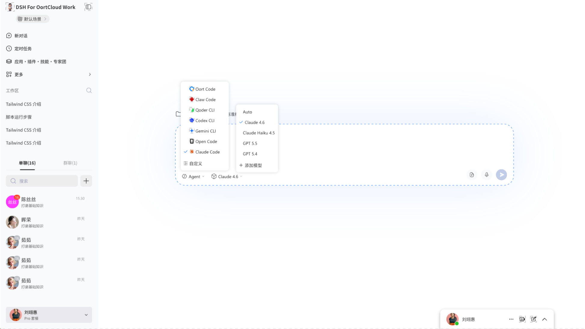

<h1 align="center">DSH For OortCloud Work</h1>

<p align="center"><strong>Work tasks, done automatically</strong></p>
<p align="center"><em>Hand your work tasks to an agent — your existing web systems stay exactly as they are.</em></p>

<p align="center">
  English | <a href="README.zh-CN.md">简体中文</a>
</p>



## 📖 Overview

DSH For OortCloud Work is a work-task automation desktop program for OortCloud Work, built on DeepSeek Harness Desktop (DSH). Describe a work task in natural language, and the agent understands the page, plans the steps, performs the operations, and reports back. It replaces traditional RPA scenarios with agentic automation, with a particular focus on automating operations on existing ("legacy") web systems — no rebuild, no migration, and no API retrofit required.

It is also OortCloud's enterprise-grade scenario-based groupware: one desktop carries 70+ OortCloud service scenarios and lets you switch between them at any time. This is OortCloud's most core, most critical, and most exciting desktop product.

In addition, every product in the OortCodex series ships with pioneering multi-environment sign-in technology: the China site and the international site share one program, so two separate builds never need to be published.

> **Work tasks, done automatically.**

## ✨ Highlights

- **Natural language is the task.** Describe the work in plain words; the agent plans the steps, does the work, and reports back.
- **A replacement for traditional RPA.** No recorded scripts, no fragile selectors or fixed coordinates — the agent adapts when the interface changes and keeps going.
- **Legacy-friendly by design.** Automate the web systems you already run, without touching a line of their code, so existing investments keep paying off.
- **Enterprise groupware.** One desktop carries 70+ OortCloud service scenarios — switch anytime, use what you need.
- **Multi-environment sign-in.** One program for both the China and international sites: no duplicate releases, no double maintenance.

## 🤖 Agentic automation: a replacement for traditional RPA

Traditional RPA relies on recorded scripts, selectors, and fixed coordinates: when the interface changes, the script breaks, and someone has to maintain it. DSH For OortCloud Work hands the task to an agent — it understands the semantics of the page, plans and executes multi-step operations on its own, and hands the result back to you.

| Dimension         | Traditional RPA                        | DSH For OortCloud Work                  |
| ----------------- | -------------------------------------- | ---------------------------------------- |
| Task definition   | Recorded actions / written scripts     | Describe the task in natural language    |
| Page understanding| Selectors and fixed coordinates        | The agent understands page semantics     |
| Interface changes | Scripts break; re-recording required   | Adapts and keeps going                   |
| Applicable systems| Usually requires system changes         | Especially strong on existing (legacy) web systems |
| Maintenance       | Dedicated script maintainers           | The task is the description — edit and rerun |

### Working with existing web systems

A company's most valuable business logic often lives in web systems that have been running for years. DSH For OortCloud Work does not ask you to rebuild, migrate, or refactor those systems — the agent simply operates on the existing pages. The value of your legacy systems carries on, and automation arrives on day one.

## 🏢 Enterprise scenario-based groupware

- One desktop carries **70+ OortCloud service scenarios**, switchable at any time.
- It is both a work-task automation tool and the unified desktop entry to OortCloud's scenario-based services.
- It is OortCloud's **most core, most critical, and most exciting** desktop product.

## 🌏 Multi-environment sign-in technology

- Pioneered across the OortCodex product series.
- The China site and the international site share one program — just pick the environment at sign-in.
- No more developing, testing, and publishing two separate programs for two sites.

## 🚀 Quick Start

### Download

Get the installer from [Releases](https://gitcode.com/OortCloudGroup/DSH-OortCloud-Work/releases):

- **Windows**: `.exe` installer

### Auto-update

The client reads [latest.json](latest.json) at the repository root to obtain the latest version, download URL, and SHA-256 checksum, then handles version detection and updates automatically.

### First run

1. Launch DSH For OortCloud Work.
2. Sign in with your OortCloud account and choose the China or international environment.
3. Switch to the scenario you need among the 70+ service scenarios.
4. Describe your work task in natural language and let the agent operate the web system for you.

## 🛠 Tech stack

Built on DeepSeek Harness Desktop (DSH): an Electron desktop client, an agent runtime, and built-in browser operation — task understanding, step planning, and page execution close the loop in one framework.

## 🤝 Contributing

All forms of contribution are welcome:

1. Fork this repository
2. Create your feature branch (`git checkout -b feature/AmazingFeature`)
3. Commit your changes (`git commit -m 'feat: add some feature'`)
4. Push to the branch (`git push origin feature/AmazingFeature`)
5. Open a Pull Request

## 🐛 Bug Reports & Feedback

If you run into an issue or have an improvement in mind, please open an issue on GitHub / GitCode.

## 🔧 Quick script to update latest.json

Run the following in PowerShell:

```powershell
# Update latest.json with the given version; default EXE path: G:\lanjian\nginx\html_88_56\OortCodex-Desktop.exe
.\scripts\update-latest.ps1 -Version "1.0.1"

# Use a custom executable path
.\scripts\update-latest.ps1 -Version "1.0.2" -ExePath "G:\lanjian\nginx\html_88_56\OortCodex-Desktop.exe"
```

## 📄 License

This project is licensed under the MIT License — see the [LICENSE](LICENSE) file for details.

## 🙏 Acknowledgements

Thanks to every developer who has contributed to DSH For OortCloud Work.

### Tagline

**DSH For OortCloud Work — work tasks, done automatically.**
